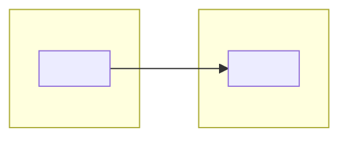
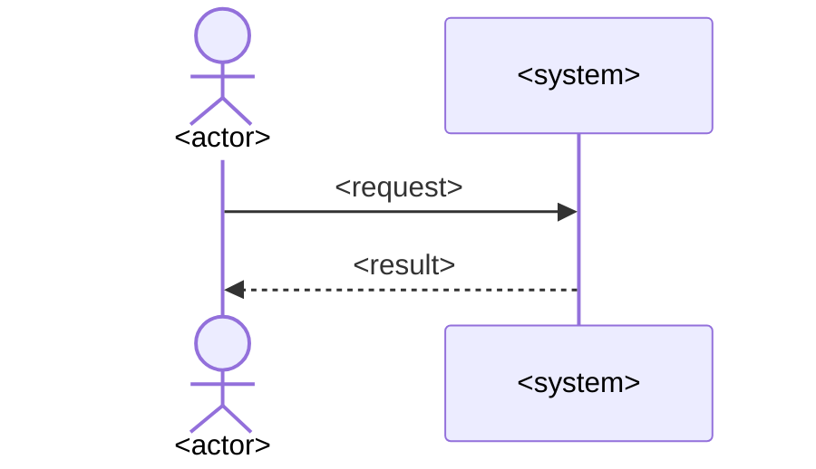
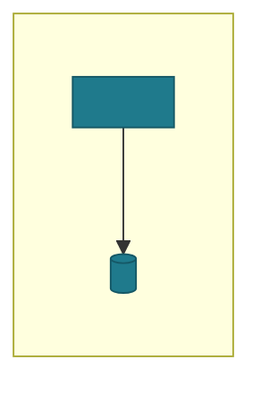
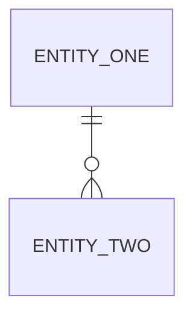

# High-level architecture: <system or change name>

```yaml
architecture_owner: "<name>"
document_version: "0.1"
date: "<YYYY-MM-DD>"
status: draft
reviewers:
  - "<name given by the owner>"
signed_off_by: ""
signed_off_on: ""
review_conditions: []
system: "<product or system>"
domains:
  - "<domain>"
capabilities:
  - "<capability added or changed>"
target_production_date: "<YYYY-MM-DD>"
review_level: <full-or-pattern-check>
impact_flags:
  - <flag>
data_classification: <public-internal-confidential-or-restricted>
security_consultation_required: <true-or-false>
solution_type: <greenfield-brownfield-or-modernization>
decision_needed:
  - "<question the reviewers answer with a choice>"
decision_deadline: "<YYYY-MM-DD>"
reference_pattern: "<pattern followed, or delete the line>"
exceptions:
  required: <true-or-false>
  link_or_reason: ""
repositories:
  - "<repository>"
adr_registry_commit: "<commit, or none>"
```

## Digest

<!-- The abstract, at most 10 lines: what is proposed, for whom, why now, the decisions that shape it, and what reviewers must decide. Later stages read only this. -->

- <what is proposed, and the outcome it serves>

## Business driver, problem and outcome

<!-- The problem in business terms, what it costs today, and a measurable outcome with a date. Every figure names its source. -->

| Item | Detail |
| --- | --- |
| Problem | <who has it and how it shows> |
| Cost of doing nothing | <figure and source> |
| Outcome and measure | <metric, target, date> |
| Why now | <deadline, contract, end of support, cost> |

## Scope

<!-- Deliverables, not activities. An assumption is something a reviewer could prove false; say what changes if it is. -->

| Category | Items |
| --- | --- |
| In scope | <deliverable><br/><deliverable> |
| Out of scope | <item, and where it is handled instead> |
| Assumptions | <assumption: what changes if false> |

## Design decisions

<!-- Optional. Only departures from ADRs, novel approaches, trade-offs other teams carry, and calls where reasonable architects would disagree. The first column names the tension. The review column stays empty: it is the organisation reviewers' record. -->

| Tension | Decision and reason | Id | Signed off by |
| --- | --- | --- | --- |
| <force versus force> | <what was chosen, and why> | <D-id> | |

## Risks and mitigation

<!-- At most five, ranked. Every departure from an accepted ADR appears here. A mitigation changes likelihood or impact; watching is not one. -->

| Risk | Likelihood / impact | Mitigation | Owner (role) | Reviewer decision |
| --- | --- | --- | --- | --- |
| <risk> | <low-medium-high> / <low-medium-high> | <mitigation> | <role> | <question, or none> |

## Conceptual design

<!-- The domain in one picture: main concepts, their relationships, the bounded context that owns each. Business nouns only, no technology. Then a paragraph and the term table. -->



<what the concepts mean, which context owns each, and where each one's truth lives>

| Term | Meaning | Owning context | Source of truth |
| --- | --- | --- | --- |
| <term> | <definition> | <context> | <system> |

## Users, journeys and flows

<!-- Optional. The main journeys or data flows from trigger to result, sync or async per step, the failure the user sees, and which ships first. -->

| Journey or flow | Actor and trigger | Result | First release |
| --- | --- | --- | --- |
| <name> | <actor: trigger> | <result> | <yes-or-no> |



<the steps, what is synchronous, and what happens when a step fails>

## Proposed architecture

<!-- Context view, container view, the end-to-end flow that matters most, and one line per container citing the ADR or decision behind its technology. -->


<context: who and what the system exchanges with>



<containers and how they talk; the key flow as a sequence diagram if it differs from the one above>

| Container | Responsibility | Technology | Basis |
| --- | --- | --- | --- |
| <container> | <one sentence> | <technology> | <ADR-id or D-id> |

## Data and integration

<!-- Optional. New or changed data and interfaces only. -->

| Item | Detail |
| --- | --- |
| Data stores | <new-or-existing, type, owner, why> |
| Interfaces | <name: producer to consumer, kind, format, contract location, versioning> |
| Data quality | <dimension: rule, where checked> |
| Retention and deletion | <data: period, trigger, basis> |
| Migration or backfill | <approach> |



<the new or changed entities and their keys>

## Non-functional requirements

<!-- Numbers with units and where each is measured, derived from user impact. Keep only targets that change the design. -->

| Quality | Target | Measured at |
| --- | --- | --- |
| Availability | <target> | <point> |
| Latency | <P95 and P99 per flow> | <point> |
| Throughput and volume | <now, and in two to three years> | <point> |
| Freshness | <target> | <point> |
| Recovery | <RPO / RTO> | <point> |
| Observability | <top metrics, tracing, what alerts> | <tool> |
| Cost guardrail | <budget or unit cost> | <report> |
| Compliance | <obligation> | <evidence> |

## Security and privacy

<!-- Authentication and permissions for every actor, secrets, encryption, personal data, audit, main threats. Say why the consultation flag has its value. -->

| Topic | Approach | Basis |
| --- | --- | --- |
| Authentication | <people; services> | <ADR-id or D-id> |
| Authorization | <roles, groups, scopes; where enforced> | <basis> |
| Secrets and keys | <approach> | <basis> |
| Encryption | <in transit; at rest> | <basis> |
| Personal and sensitive data | <what, minimisation, residency> | <basis> |
| Audit | <events, retention, protection> | <basis> |
| Threats | <threat: mitigation> | <basis> |
| Security consultation | <true-or-false: the trigger> | <answer id> |

## Developer experience

<!-- Optional. How a developer finds, runs, tests and releases this. -->

| Topic | Approach |
| --- | --- |
| Repositories and layout | <approach> |
| Local development | <approach> |
| Test strategy | <test types per container> |
| Build, release and rollback | <approach> |
| Environments and configuration | <approach> |

## Modernization plan

<!-- Optional. Required when solution_type is modernization. Rollback triggers are thresholds someone can watch. -->

| Topic | Plan |
| --- | --- |
| Strategy | <strangler, parallel run, phased or one cutover; why> |
| Transition state | <what runs side by side, for how long> |
| Data migration and reconciliation | <method, tolerance> |
| Cutover | <criteria and steps> |
| Rollback | <trigger thresholds; steps; point of no return> |
| Retirement | <component: condition, date, who decides> |

## Architecture options considered

<!-- Optional. Two or three real alternatives judged on the same criteria; why the chosen one wins; what would reopen the choice. -->

| Option | Strengths | Weaknesses | Verdict |
| --- | --- | --- | --- |
| <option> | <strengths> | <weaknesses> | <chosen, or why rejected> |

Revisit when: <condition>

## AI input block

<!-- The hand-off to Inception: decisions restated as data. Every MUST cites a decision or ADR; every criterion is testable. Keep the keys. -->

```yaml
constraints:
  must:
    - "<constraint> (<D-id or ADR-id>)"
  should:
    - "<constraint> (<D-id or ADR-id>)"
interfaces:
  - "<name> | <api-event-or-file> | <producer> -> <consumer> | <contract>"
acceptance_criteria:
  - "<testable criterion>"
test_expectations:
  - "<test kind>: <threshold>"
open_items:
  - "<what Inception must still settle>"
```

## Appendix: design method

<!-- How the design was reached, so a reviewer can judge its basis. -->

| Practice | Applied to | Evidence |
| --- | --- | --- |
| Design layers worked (twelve) | <groups and layers> | <question files> |
| Decision record | <D-id range> | hla-decisions.md |
| ADR registry | <commit> | <index path> |
| Inputs read | <documents and code knowledge> | <paths; anything unreadable> |
