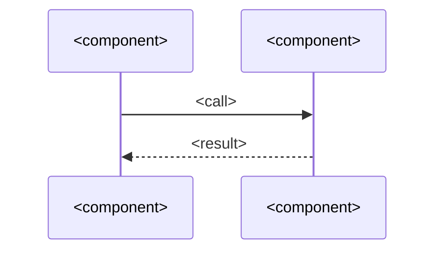

# Technical design: <service or component>

```yaml
architecture_owner: "<name>"
document_version: "0.1"
date: "<YYYY-MM-DD>"
status: draft
reviewers:
  - "<name given by the owner>"
signed_off_by: ""
signed_off_on: ""
service_name: "<service or component>"
hla_link: "<path to the accepted HLA, normally hla.md>"
trigger:
  - <review-request, an impact flag, or override>
adr_links: []
review_conditions: []
exception_link: "<where the exception is recorded, or delete the line>"
```

## Digest

<!-- At most 10 lines: what this delivery builds, why a TDD was required, the decisions new here, what reviewers must check. -->

- <what is built, and why a TDD was required>

## Overview and scope

<!-- What this delivery covers and which HLA decisions it implements, by id. Point to the HLA; do not restate it. -->

| Item | Detail |
| --- | --- |
| Delivery scope | <what ships> |
| HLA decisions implemented | <D-ids> |
| Not in this delivery | <item, and where it goes> |
| Inputs | <documents and code knowledge read> |

## Design decisions

<!-- Optional. Decisions new in this TDD, ids continuing after the HLA record. Only tensions, not routine choices. Sign-off column stays empty. -->

| Tension | Decision and reason | Id | Signed off by |
| --- | --- | --- | --- |
| <force versus force> | <what was chosen, and why> | <D-id> | |

## Detailed architecture

<!-- Container view only if it changed since the HLA. At most two flows critical to this delivery. One line per component built or changed here. -->

| Component | Responsibility in this delivery | Change | Basis |
| --- | --- | --- | --- |
| <component> | <one sentence> | <new-or-changed> | <D-id or ADR-id> |



<the flow, and what happens when a step fails>

## Interfaces and contracts

<!-- Optional. Per API, event or file: where the schema lives and its version, the compatibility and deprecation rule, errors, retries with backoff, the idempotency key. -->

| Interface | Contract and version | Compatibility | Errors, retries, idempotency |
| --- | --- | --- | --- |
| <name> | <location, version> | <rule> | <behaviour> |

## Data design

<!-- Optional. New or changed data only. -->

| Item | Detail |
| --- | --- |
| Schema changes | <tables, fields, types> |
| Keys and indexes | <key: query it serves> |
| Partitioning | <scheme and why> |
| Lifecycle | <retention, archive, deletion> |
| Lineage and owner | <source to target; owning team> |

## Security design

<!-- What this delivery adds: threats with mitigations, roles and scopes, secrets, encryption, audit events. Cite the HLA security decisions it refines. -->

| Topic | Design | Basis |
| --- | --- | --- |
| Threats | <threat: mitigation> | <basis> |
| Roles and scopes | <role: permissions> | <basis> |
| Secrets and keys | <store, rotation> | <basis> |
| Encryption | <in transit; at rest> | <basis> |
| Audit | <events, retention, protection> | <basis> |

## Reliability and operations

<!-- Service levels, capacity limits, resilience settings with values, recovery and how often it is tested, runbooks and who operates it. -->

| Topic | Design |
| --- | --- |
| Service levels | <objective, error budget> |
| Capacity and scaling | <limits, scaling trigger> |
| Resilience | <timeouts, retries, circuit breaking, backpressure: values> |
| Backup and recovery | <RPO / RTO, restore test cadence> |
| Runbooks and ownership | <runbook location, operating team> |

## Observability

<!-- Metrics that show health and the business outcome, log fields and correlation id, traced spans and sampling, and which conditions alert a person versus open a ticket. -->

| Signal | Design |
| --- | --- |
| Metrics | <metric: meaning> |
| Logs and correlation | <fields, correlation id> |
| Tracing | <spans, sampling> |
| Alerts | <condition: alert or ticket, threshold> |

## Performance and cost

<!-- Optional. Load assumptions, targets at P50/P95/P99, how they are tested, cost drivers and a guardrail. -->

| Item | Detail |
| --- | --- |
| Load | <baseline, peak> |
| Targets | <operation: P50 / P95 / P99> |
| Performance test | <approach, environment, pass mark> |
| Cost drivers and guardrail | <driver; guardrail> |

## Testing and validation

<!-- Test types with scope and pass criteria: unit, integration, contract, security scanning, data quality, failure scenarios. -->

| Test type | Scope | Pass criteria |
| --- | --- | --- |
| <type> | <scope> | <criteria> |

## Release readiness

<!-- What must be true before release starts, what is watched during it, rollback triggers and steps, who approves and who executes. -->

| Item | Detail |
| --- | --- |
| Preconditions | <item> |
| Watched during release | <dashboard, alert> |
| Rollback | <triggers; steps> |
| Roles | <approves release; executes; approves rollback> |

## Post-release validation

<!-- What is checked after release, by whom, when, the expected result, and the result that triggers rollback or a fix-forward. -->

| Check | Who | When | Expected result | If it fails |
| --- | --- | --- | --- | --- |
| <check> | <role> | <time after release> | <result> | <rollback-or-fix-forward> |

## Risks and mitigations

<!-- Known risks for this delivery, seen from the user's side, each with an owner and whether it blocks release. -->

| Risk | Impact on users | Mitigation | Owner | Blocks release |
| --- | --- | --- | --- | --- |
| <risk> | <impact> | <mitigation> | <role> | <yes-or-no> |

## AI input block

<!-- The hand-off to Inception and Construction. Tasks become stories; every MUST cites a decision or ADR. Keep the keys. -->

```yaml
tasks:
  - "<task ready to become a story> (<section>, <D-id>)"
constraints:
  must:
    - "<constraint> (<D-id or ADR-id>)"
  should:
    - "<constraint> (<D-id or ADR-id>)"
definition_of_done:
  - "<security, observability, test or runbook item>"
post_release_checks:
  - "<request or query> -> <expected result>"
```

## Appendix: quality attribute prompts

<!-- Prompts, not requirements. P50 is the median; P95 is what nearly every user gets; P99 is the tail under load. -->

| Attribute | Have we answered | Covered in |
| --- | --- | --- |
| Reliability | error rate; time to recover | <section, or why not relevant> |
| Efficiency | response time; throughput | <section> |
| Availability | uptime; failover time | <section> |
| Durability | integrity after failure; most data that may be lost | <section> |
| Scalability | scale-out and scale-up limits; concurrent users | <section> |
